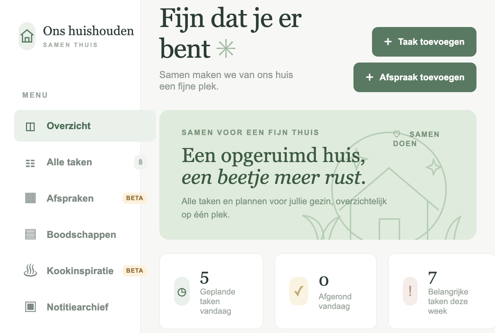

# Ons huishouden

Android-debugversie: [APK downloaden](release/household-debug.apk)

Een dashboard voor huishoudelijke taken en de planning per gezinslid.
Een huishouden deelt één dataset in een MySQL/MariaDB-database; elk gezinslid
kan met een eigen account inloggen.

Publicatie: <https://betyre.alwaysdata.net/household/>



## Gebruik van de app

### Eerste keer gebruiken

Bij een nieuw account bevat de app fictieve voorbeeldgegevens: Mama, Papa en
Kind, zonder geboortedatums, enkele huishoudelijke taken met een
voorbeeldplanning en enkele gerechten voor kookinspiratie. Je kunt deze
gegevens aanpassen of verwijderen.
Vul bij je eigen gezinslid onder **Ons gezin** hetzelfde e-mailadres in als
waarmee je inlogt. De naam van dat gezinslid verschijnt dan bovenaan; zonder
koppeling staat daar **Gezinslid**.

### Overzicht en taken

Op het overzicht staat de taakverdeling per gezinslid voor de gekozen dag en
voor de hele bijbehorende week (maandag tot en met zondag). Standaard wijs je
een taak aan één gezinslid toe. Zet in het taakvenster **Taak door meerdere
gezinsleden laten uitvoeren** aan om meerdere personen te selecteren; de taak
verschijnt dan bij ieder van hen. Een terugkerende taak telt voor elke dag
waarop die is ingepland.
Zet bij een taak **Vrij op te nemen taak** aan om die zonder toewijzing onder
**Vrij op te nemen taken** in de dagplanning te tonen. Een open taak schuift
dagelijks door. Als de volgende reguliere frequentiedag aanbreekt terwijl de
taak nog openstaat, blijft hetzelfde exemplaar staan; na afvinken verschijnt
het volgende exemplaar pas op de eerstvolgende reguliere frequentiedag.

### Afspraken

Via **Afspraken** (beta) kun je afspraken toevoegen, wijzigen en verwijderen.
Een maandkalender boven de lijst toont het aantal afspraken per dag; met de
pijlen blader je naar andere maanden. Een afspraak telt één keer per dag,
ook als meerdere gezinsleden eraan zijn gekoppeld. Onder de huidige maand staan
alle afspraken die nog niet zijn afgelopen. Blader naar een andere maand om
de afspraken in die maand te zien, ook als ze al voorbij zijn. Kies een dag
om alleen de afspraken van die dag te tonen, ook voor eerdere dagen in de
huidige maand. De lijst is gesorteerd op begindatum en begintijd.
Een afspraak heeft een begin- en einddatum en een begin- en eindtijd, of duurt
een hele dag. Bij afspraken voor hele dagen telt ook de einddatum mee; bij
afspraken met tijd is het eindtijdstip exclusief. Bij het wijzigen van de
begindatum schuift een eerdere einddatum automatisch mee naar de begindatum;
een latere einddatum blijft staan. Meerdaagse afspraken staan op elke betrokken
dag in de weekplanner. Koppel een afspraak eventueel aan één
of meer gezinsleden: ze staat dan boven de taken van elk geselecteerd gezinslid.
Afspraken zonder gezinslid staan
samen met de vrij op te nemen taken bovenaan onder **Voor iedereen**. Afspraken
zijn geen taken en tellen niet mee in taakstatistieken. Kindaccounts kunnen
afspraken bekijken, maar niet beheren. Bij het verwijderen van een gezinslid
blijven afspraken bij de overige geselecteerde gezinsleden staan, of onder
**Voor iedereen** als er niemand meer is geselecteerd. Afspraken worden ook
in back-ups opgenomen; oudere back-ups zonder afspraken blijven bruikbaar.
Een afspraak kan wekelijks, elke twee weken, maandelijks of jaarlijks herhalen,
telkens vanaf de gekozen begindatum en eventueel tot
en met een gekozen einddatum voor de start van de laatste herhaling. Als een
maand of jaar de oorspronkelijke dag niet heeft, wordt die herhaling
overgeslagen. In de lijst met aankomende afspraken staat de eerstvolgende
afspraak per reeks. Kies bij bewerken of verwijderen voor één afspraak of de
hele reeks. Uitzonderingen blijven bestaan als de reeks wordt aangepast; een
reeks met uitzonderingen kan niet worden omgezet naar een eenmalige afspraak.
De huidige dag is gemarkeerd in de maandkalender.
Onder **Ons gezin** staat ook de aanmaakdatum van elk gezinslid. Via
**Statistieken bekijken** zie je hoeveel taakmomenten er vanaf die datum tot
en met vandaag volgens de huidige planning aan die persoon waren toegewezen,
hoeveel daarvan zijn afgevinkt en hoeveel daarvan te laat zijn afgevinkt. Een
te late taak telt mee voor de gezinsleden aan wie die op de geplande dag was
toegewezen, ongeacht welk account de taak heeft afgevinkt. Een taak geldt als
te laat wanneer die na de geplande dag wordt afgevinkt; oudere afvinkjes zonder
registratiedatum tellen niet mee als te laat.
Bij oudere profielen waarvan de
aanmaakdatum niet werd opgeslagen, kun je de datum aanvullen via
**Gegevens bewerken**; zonder datum zijn de statistieken niet te berekenen.
De statistieken tonen daarnaast per gezinslid het aantal aangemaakte taken,
boodschappen, gerechten en berichten en het aandeel daarvan binnen de
geregistreerde aanmaakacties in die categorie sinds die datum. Items die al
bestonden voordat de makerregistratie beschikbaar was, tellen niet mee.
Voor makerstatistieken moet het account via het e-mailadres aan een gezinslid
zijn gekoppeld.

## Demo proberen

Kies op het aanmeldscherm **Demo proberen** om zonder account met fictieve
gezinsleden, taken, boodschappen, gerechten en een notitie te oefenen.
Je kunt gegevens en kleuren aanpassen, maar alles bestaat alleen tijdelijk in
het huidige tabblad: bij **Demo afsluiten** of herladen verdwijnen de
wijzigingen. Demo-inhoud wordt niet naar de database of een nieuw account
overgezet. Uitnodigingen, wachtwoordreset en back-ups zijn alleen beschikbaar
met een echt account. Gebruik geen persoonlijke gegevens in de demo.

## Bestaande browsergegevens overzetten

Maak **vóór het vervangen van de oude versie** via **Instellingen** een
JSON-export op het apparaat en in de browser waar de gegevens staan. Maak
vervolgens een account in de nieuwe versie en zet het bestand daar terug via
**Instellingen**. Dit vervangt de accountgegevens en wordt niet samengevoegd.
Herhaal dit niet zomaar voor meerdere apparaten: elke import vervangt de vorige.
De oude browsergegevens worden niet automatisch overgenomen of gewist. Is de
oude site al vervangen zonder export, dan moet de oude versie weer op
dezelfde browser-origin (protocol, host en poort) beschikbaar zijn om daar
de gegevens te kunnen exporteren.

Via **Bekijken** bij **Ons gezin** op het overzicht kun je gezinsleden
beheren. Bij elk gezinslid kun je optioneel een geboortedatum en e-mailadres
invullen. Gebruik het e-mailadres waarmee diegene inlogt als het gezinslid
een eigen account heeft; dit is een profielgegeven en koppelt accounts niet
automatisch. De app toont
de leeftijd rekening houdend met de verjaardag; voor 29 februari is dat in
een niet-schrikkeljaar vanaf 1 maart. Als alleen een eerder opgegeven
geboortejaar bekend is, toont de app het verschil met het huidige jaar met
een vermelding dat de verjaardag onbekend is. Een eerder opgegeven leeftijd
blijft zichtbaar totdat je een geboortedatum invult.
Verjaardagen verschijnen jaarlijks met een taartje in de weekagenda, vanaf de
eerste verjaardag. Voor 29 februari verschijnt de verjaardag in een
niet-schrikkeljaar op 1 maart. Verjaardagen tellen niet mee als taken.

Op **Ons gezin** kun je ook gezinsleden uitnodigen voor hetzelfde dashboard.
Selecteer desgewenst een bestaand gezinslid om het account na acceptatie aan
dat profiel te koppelen, of kies **Nieuw gezinslid** en selecteer alleen de
rol (ouder of kind). Vul het e-mailadres voor de login in en deel de link
persoonlijk; de app verstuurt zelf geen e-mail. De ontvanger stelt via die link
een eigen wachtwoord in en krijgt een aparte login. Uitnodigingen zijn zeven
dagen geldig en kunnen worden ingetrokken zolang ze niet zijn geaccepteerd.
Alle accounts in het huishouden zien dezelfde gezinsgegevens. Alleen ouders
kunnen uitnodigingen maken of intrekken. Kindaccounts kunnen geplande taken
aan- en afvinken, maar geen taken toevoegen, wijzigen, verwijderen of
inplannen. Ze kunnen boodschappen en gerechten toevoegen en de bijbehorende
checkboxes gebruiken, maar geen bestaande items wijzigen of verwijderen.
Kinderen kunnen notities plaatsen, maar niet bewerken, archiveren, herstellen
of verwijderen. Bij instellingen kunnen zij alleen hun kleurenpalet aanpassen;
de persoonlijke teksten en back-ups zijn voor ouders. Kinderen kunnen geen
bestaande gezinsleden bewerken of verwijderen, maar wel een gezinslid toevoegen.
Een genodigde heeft een
nieuw account nodig: een bestaand account kan niet aan een uitnodiging worden
gekoppeld. Bij acceptatie wordt het e-mailadres van het gekozen profiel
bijgewerkt naar het e-mailadres waarmee het account inlogt.

### Accounts en wachtwoord

Registratie staat open voor iedereen die de site kan bereiken. Het e-mailadres
is een gebruikersnaam en wordt niet geverifieerd; er is geen e-mailverificatie
of zelfstandig wachtwoordherstel via e-mail. Een ouder kan op **Ons gezin** bij
een ander account in hetzelfde huishouden een eenmalige resetlink maken. Deel
die link rechtstreeks met de betreffende gebruiker: de link is één uur geldig,
wordt na gebruik onbruikbaar en laat de gebruiker zelf een nieuw wachtwoord
kiezen. Bestaande sessies van dat account worden na de reset beëindigd. Deel de
link niet openbaar; iedereen die de link ontvangt kan het wachtwoord resetten.
Bewaar je wachtwoord veilig.

## Notities

Onder de weekplanning op **Overzicht** staat het notitieblok voor het hele
huishouden. Plaats een notitie met titel en beschrijving; de auteur wordt
automatisch ingevuld met je profielnaam, of met je login-e-mailadres als er
geen gekoppeld profiel is. Een ander gezinslid kan de notitie bewerken; de app
vermeldt dan diens naam en het tijdstip als bewerker.
Markeer een notitie als belangrijk bij het plaatsen of bewerken; nieuwe en
oudere notities zijn standaard niet belangrijk. Op het overzicht staan de
notities als post-its in een grid, met belangrijke notities eerst. Het gezin
staat naast de weekplanning en de notities staan daaronder. Voeg een notitie
toe met de plusknop. Via het driepuntjesmenu op een post-it kun je die
bewerken of archiveren; in het archief gebruik je hetzelfde menu om een
notitie te herstellen of definitief te verwijderen.
Kindaccounts kunnen met de luidsprekerknop op een post-it de titel en
beschrijving laten voorlezen.
Archiveer notities om ze van het overzicht te halen. Via **Notitiearchief**
kun je ze herstellen of definitief verwijderen.

## Plannen

Klik op een taak in **Alle taken** om de planning te bewerken. Per ingepland
moment is één gezinslid verantwoordelijk:

- Dagelijks: kies per weekdag een gezinslid; een lege dag wordt overgeslagen.
- Wekelijks: kies een weekdag en afzonderlijk een gezinslid voor even en
  oneven ISO-weken. Laat een week leeg om die over te slaan.
- Maandelijks: kies een gezinslid en een dag van de maand. Ontbreekt die dag
  in een maand, dan wordt die maand overgeslagen.
- Jaarlijks: kies een gezinslid en eventueel een dag en maand. Het gekozen
  jaartal wordt genegeerd; op 29 februari valt de taak alleen in schrikkeljaren.

Vink in het taakformulier **Markeer als belangrijk** aan om een taak extra
opvallend te labelen. Het uitroepteken bij de taak geeft dit aan op het overzicht en in
**Alle taken**. Oudere back-ups zonder deze instelling blijven geldig; die
taken zijn standaard niet als belangrijk gemarkeerd.
Een taak zonder gezinslid of een jaarlijkse taak zonder datum staat wel in de
takenlijst, maar niet op de kalender. Afvinken geldt voor de afzonderlijke
geplande datum. Bestaande planningen worden automatisch overgenomen.
De tegels boven de weekplanning tonen het aantal geplande taken vandaag,
afgeronde taken vandaag en ingeplande belangrijke taken in de weergegeven week.
De taken van de geselecteerde dag staan gegroepeerd per verantwoordelijke.
Kindaccounts kunnen met de luidsprekerknop naast een taak of gezinslid de
taaknaam of naam laten voorlezen. Ouders zien deze knoppen niet.
De website gebruikt hiervoor de spraakfunctie van de browser. De Android-app
gebruikt de tekst-naar-spraakfunctie van het apparaat. Installeer zo nodig een
Nederlandse stem via de tekst-naar-spraakinstellingen van Android.
Voor de geselecteerde dag toont de staafgrafiek **Verdeling per gezinslid**
hoeveel taken ieder gezinslid heeft, inclusief afgevinkte taken. De langste
staaf geeft het hoogste aantal van die dag weer. Verjaardagen tellen niet mee.
In **Alle taken** geeft het label **Ingepland** of **Niet ingepland** aan of
minstens één moment met een gezinslid is ingesteld. Een jaarlijkse taak met
een ingevulde dag en maand blijft als ingepland aangeduid.
Filter op planningsstatus via **Alle statussen** of klik op de kolomkop
**Status** om de volgorde om te keren.
Met het kruisje in het zoekveld maak je de zoektekst leeg zonder de andere
filters te wijzigen.

Eerder samengevoegde taken behouden hun schema's en afvinkjes. Hun schema's
kun je via **bewerken** afzonderlijk aanpassen; bij overlap heeft het eerste
passende schema voorrang.

Wijzigingen worden na opslaan aan het account op de server gekoppeld. Open je
de app op een ander apparaat, log dan in met hetzelfde account. Gegevens
worden niet automatisch live bijgewerkt in een al geopend tabblad: herlaad
dat voordat je verder werkt. Bij het opslaan probeert de app wijzigingen aan
verschillende gegevens automatisch samen te voegen met de nieuwste versie op
de server. Wijzigingen aan hetzelfde item, of wijzigingen die niet veilig kunnen
worden samengevoegd, kunnen nog steeds een conflict geven. Back-ups worden niet
automatisch samengevoegd: terugzetten vervangt de gegevens. Bij een mislukte of
niet bevestigde opslag kan een ouder de lokale wijziging eerst als back-up
downloaden en daarna herladen. Kindaccounts kunnen herladen; de laatste
niet-bevestigde wijziging kan dan verloren gaan. Terugzetten van een back-up
vervangt de servergegevens.

## Boodschappen

Via **Boodschappen** kun je producten toevoegen, afvinken als ze gekocht zijn
en verwijderen. Afgevinkte producten blijven staan totdat je ze verwijdert en
staan onderaan de lijst; je kunt ze ook opnieuw aanvinken als nodig. Niet
afgevinkte dringende boodschappen staan boven andere niet-afgevinkte producten.
Met het vlaggetje naast een product markeer je het als dringend of verwijder je
die markering. Ook bij afgevinkte producten blijft de markering bewaard. De
lijst hoort bij je account.

## Kookinspiratie

Via **Kookinspiratie** kun je gerechten of voeding toevoegen en verwijderen.
Vink per gerecht aan welke gezinsleden er zin in hebben; je kunt die wensen
ook weer uitvinken. De gerechten met de meeste wensen staan bovenaan. Per
gerecht zie je het aantal geïnteresseerde gezinsleden en een markering als
meer dan de helft van de gezinsleden er zin in heeft. Met **Recept zoeken**
open je een zoekopdracht voor recepten van dat gerecht in een nieuw tabblad.
Kindaccounts kunnen een gerecht met de luidsprekerknop laten voorlezen.
Bij het verwijderen van een gezinslid verdwijnen diens wensen, maar de
gerechten blijven staan. De lijst hoort bij je account.

## Instellingen en back-up

Via **Instellingen** kun je de titel van de website (standaard **Ons
huishouden**), de ondertekst van het logo (standaard **SAMEN THUIS**), de
welkomsttitel en -tekst en de kleine boodschap in het zijpaneel aanpassen. Deze teksten worden
gedeeld met alle gezinsaccounts en opgenomen in de back-up. Met
**Standaardteksten herstellen** zet je ze terug naar de oorspronkelijke tekst.

Je kunt op deze pagina ook kiezen uit de kleurenpaletten Bosgroen,
Oceaanblauw, Lavendel en Terracotta. Het gekozen palet wordt per login
opgeslagen, geldt ook in de donkere modus en verandert de weergave voor andere
gezinsaccounts niet. Bestaande accounts beginnen met Bosgroen.

In het vak **Sessie en spraak** worden de selectievakjes meteen opgeslagen
zodra je ze aan- of uitvinkt. **Deze sessie is voor iedereen in het gezin**
is bedoeld voor een apparaat waarop meerdere personen dezelfde login
gebruiken. De keuze wordt lokaal in de browser van dat apparaat bewaard,
geldt daar voor alle accounts en wordt niet naar andere apparaten
gesynchroniseerd. Als de optie aanstaat, blijft een afgevinkte taak gekoppeld
aan de ingeplande persoon. Als ze uitstaat, wordt de afgevinkte taak
toegerekend aan het gezinslid dat aan de ingelogde account is gekoppeld, alleen
voor die ene herhaling. Dit geldt ook voor taken die voor iedereen zijn
ingepland: na het afvinken verschijnen ze bij dat gezinslid. De planning van
volgende herhalingen blijft ongewijzigd. Bovenaan de app verschijnt een
melding zolang de optie actief is. Ouders kunnen in hetzelfde vak
**Spreekknoppen ook tonen voor volwassenen** aan- of uitzetten; kindaccounts
houden hun spreekknoppen.

Je kunt hier ook handmatig een JSON-bestand downloaden met gezinsleden, taken,
planningen, afvinkjes, boodschappen, kookinspiratie, notities en persoonlijke teksten.
Bewaar dit bestand veilig: het bevat persoonlijke gegevens. Je voorkeur voor
lichte of donkere modus en je persoonlijke kleurenpalet staan niet in de back-up.

Kies op dezelfde pagina een eerder gedownload bestand en klik op **Back-up
terugzetten**. Na bevestiging worden de huidige gegevens van je huishouden
vervangen, niet samengevoegd. Maak eventueel eerst een back-up van de huidige
gegevens. Een JSON-back-up wordt niet automatisch gemaakt of bijgewerkt. Zorg daarnaast
als beheerder voor regelmatige databaseback-ups en test het terugzetten.
Oudere back-ups zonder boodschappen kunnen ook worden teruggezet; daarbij
begint de boodschappenlijst leeg. Boodschappen uit oudere back-ups zonder
dringendheidsmarkering zijn niet dringend.
Bij oudere back-ups zonder kookinspiratie begint die lijst leeg.

## Help voor gebruikers

In de app vind je via **Help** een praktische uitleg over aanmelden, het
overzicht en taken, gedeelde post-itnotities en hun driepuntjesmenu,
gezinsleden uitnodigen, boodschappen, kookinspiratie, de vier persoonlijke
kleurenpaletten, instellingen, back-ups en het gebruik op meerdere apparaten.

## Weergave

Met de knop **Donker** bovenaan schakel je donkere modus in. Met **Licht**
schakel je terug. Je keuze wordt afzonderlijk in de lokale browser bewaard.
Je persoonlijke kleurenpalet blijft daarbij actief in beide modi.
In donkere modus kleuren ook de achtergrond, panelen en invoervelden mee met
het gekozen palet.
Bij het invoeren of bewerken krijgen taken, boodschappen, gerechten,
gezinsnamen, notitietitels en gepersonaliseerde teksten automatisch een
hoofdletter aan het begin. Bestaande gegevens worden niet ongevraagd gewijzigd.

De Android-app heeft een groen launchericoon met een huisje en opent de
gepubliceerde webversie (zie de link bovenaan) in een ingebouwde WebView. De app
gebruikt dezelfde webversie en vereist geen aparte API. Aanmelden en sessies
werken binnen de WebView; links naar andere websites openen in de browser.
Back-ups downloaden en terugzetten gebruiken de bestandskiezer van Android.
Veeg bovenaan de pagina omlaag om de huidige pagina te vernieuwen.

## Project opzetten en technische informatie

### Lokaal starten

Benodigd: Node.js 20.6 of nieuwer, npm en een draaiende MySQL- of
MariaDB-server. Maak eerst een lege database en een databasegebruiker met
rechten daarop. Installeer daarna de dependencies:

```sh
npm ci
```

Maak buiten de projectmap een privébestand met bijvoorbeeld de naam
`household.env` en pas de waarden aan:

```dotenv
DB_HOST=localhost
DB_PORT=3306
DB_NAME=household
DB_USER=household
DB_PASSWORD="eigen-databasewachtwoord"
APP_ORIGIN=http://localhost:3000
PORT=3000
# Optioneel, alleen bij een submap:
# APP_BASE_PATH=/household
```

Gebruik de juiste waarden en beveilig dit bestand, bijvoorbeeld met
`chmod 600 /pad/naar/household.env`. Start vanuit de projectmap:

```sh
node --env-file=/pad/naar/household.env server.js
```

Open <http://localhost:3000>, maak een account met een e-mailadres en een
wachtwoord van minimaal 12 tekens en log in. `APP_ORIGIN` moet exact overeenkomen
met het adres in de browser, inclusief protocol en eventuele poort, zonder pad
of afsluitende slash. De server luistert standaard alleen lokaal. `IP` (of
`HOST`) en `PORT` bepalen het luisteradres; op een host achter een proxy stelt
de host deze vaak zelf in. Voor een lokale Unix-socket kan optioneel
`DB_SOCKET` worden ingesteld. Stel `DB_SSL=true` in als de databaseserver
een vertrouwde TLS-verbinding ondersteunt en vereist.
Voor een submap zet je bijvoorbeeld `APP_BASE_PATH=/household` en open je
<http://localhost:3000/household/>. Laat deze instelling weg voor de root.
Gebruik uitsluitend letters, cijfers, `_` en `-` in de padsegmenten, met
een `/` aan het begin en zonder `/` aan het einde.

### Publiceren en beveiliging

Gebruik een host die een blijvend Node.js-proces en MySQL/MariaDB ondersteunt,
niet alleen statische hosting. Installeer met `npm ci --omit=dev`, configureer
dezelfde omgevingsvariabelen en start `node server.js` met een procesbeheerder.
Plaats een HTTPS-reverse-proxy voor de app, stuur HTTP door naar HTTPS en stel
`APP_ORIGIN` in op de publieke HTTPS-origin. Voor een submap stel je daarnaast
`APP_BASE_PATH` in en stuur je het volledige pad ongewijzigd door naar Node.
Alleen voor lokaal testen is HTTP op `localhost` of `127.0.0.1` toegestaan.
Stel `TRUST_PROXY` alleen in als de exacte betrouwbare proxyadressen bekend
zijn; zonder deze instelling kan de aanmeldlimiet achter een proxy voor alle
gebruikers samen gelden.

`APP_BASE_PATH` configureert alleen de app, niet de routing van de proxy. Stuur
de requests naar `/household`, `/household/` en alle onderliggende paden,
waaronder `/household/api/`, ongewijzigd door naar het Node-proces. De app stuurt
`/household` door naar `/household/`. Als er al een andere site op het domein
staat, moet de proxy alleen dit pad naar Node doorsturen en de overige paden
ongemoeid laten. Gebruik een privé luisteradres en behoud het publieke
HTTPS-adres en de originele `Origin`-header.

Wachtwoorden worden met scrypt gehasht; sessies verlopen na zeven dagen.
Aanmeldpogingen zijn per proces en IP beperkt, dus
voor publieke of grotere installaties zijn aanvullende bescherming tegen
misbruik en monitoring via de hosting/proxy aan te raden. Beheerders van de
server en database kunnen de opgeslagen gegevens inzien. Beveilig de database,
de host en de back-ups en houd Node.js en dependencies bijgewerkt.

### Testen

Stel de databasevariabelen in voor een afzonderlijke testdatabase en voer
`npm test` uit. De integratietest maakt tijdelijke testaccounts aan en
verwijdert deze weer. Zonder databaseconfiguratie wordt de test overgeslagen.

### Android-app bouwen

Open de map `android` in Android Studio en bouw of start de app op een
Android-apparaat of emulator. Je kunt vanuit die map ook
`./gradlew :app:assembleDebug` uitvoeren. Voor een Gradle-build is JDK 17 of
nieuwer vereist. De app vraagt internettoegang en laat alleen HTTPS-verkeer
toe.

De nieuwste Android-debugversie is beschikbaar via de downloadlink bovenaan
deze README.

### Projectnotities

#### Niet doen

- Samenvoegen van taken vanuit UI, onnodig complex en weinig meerwaarde.
- Apart dashboard per gezinslid, ook hier veel te complex en weinig meerwaarde, hooguit beperkingen voor kind rol.

#### Nog te bekijken

- app vertaling voorzien
- feature requests voorzien (link naar github)
- opensource project, github
